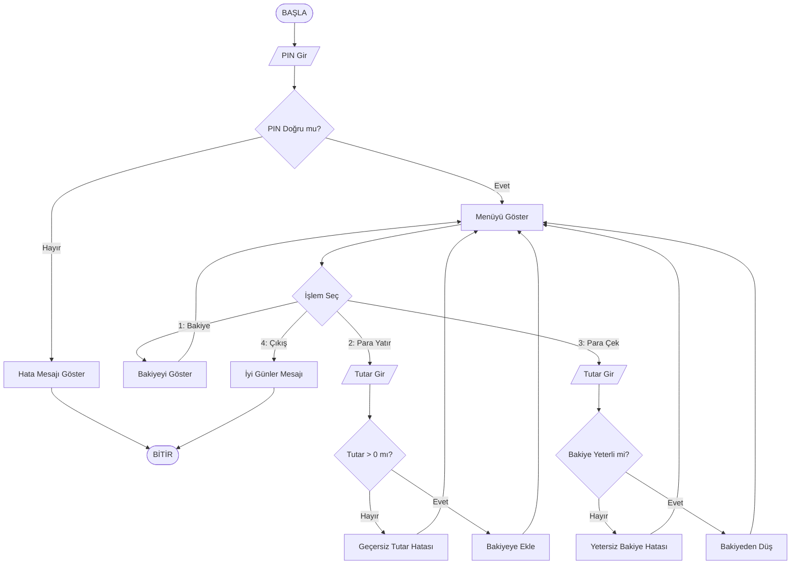

# 🏧 Bankamatik (ATM) Simülasyonu

Bu proje, Python programlama dilinin temel yapıları ve Nesne Tabanlı Programlama (OOP) prensipleri kullanılarak geliştirilmiş konsol tabanlı bir ATM uygulamasıdır.

## 🚀 Özellikler
* **PIN Doğrulama:** Kullanıcı sisteme giriş yaparken 4 haneli şifre kontrolünden geçer.
* **Bakiye Sorgulama:** Kullanıcının mevcut hesap bakiyesini görüntüler.
* **Para Yatırma:** Girilen pozitif tutarı mevcut bakiyeye ekler.
* **Para Çekme:** Yetersiz bakiye ve geçersiz tutar kontrolleri yaparak hesaptan para çeker.
* **Sürekli İşlem Döngüsü:** Kullanıcı çıkış seçeneğini (`4`) seçene kadar menü aktif kalır.

## 🏗️ Kod Mimarisi
Proje iki ana sınıf (`class`) ve bir ana yönetim fonksiyonu üzerine kuruludur:
1. **`Kullanici` Sınıfı:** Müşterinin ad-soyad bilgisini ve PIN doğrulama (`pin_dogrula`) işlemini yönetir.
2. **`BankaHesabi` Sınıfı:** Müşteriye ait bakiyeyi tutar; `bakiye_goster`, `para_yatir` ve `para_cek` metotlarıyla finansal işlemleri gerçekleştirir.
3. **`atm_baslat()` Fonksiyonu:** Programın giriş, doğrulama, menü yönlendirme ve çıkış akışını kontrol eder.

## 🔄 Çalışma Akışı (Flowchart Özeti)
1. **Başlangıç:** Sistem kullanıcı ve hesap nesnelerini tanımlar.
2. **Giriş & Kontrol:** Kullanıcıdan PIN istenir. Şifre hatalıysa uyarı verilip program sonlandırılır.
3. **İşlem Menüsü:** Şifre doğruysa kullanıcıya 4 seçenekli menü sunulur (`1: Bakiye`, `2: Para Yatır`, `3: Para Çek`, `4: Çıkış`).
4. **Çıkış:** Kullanıcı `4` tuşuna basana kadar işlemler tekrarlanır; `4` seçildiğinde döngü sonlanır ve program kapanır.

## 💻 Kurulum ve Çalıştırma
1. Bilgisayarınızda Python yüklü olduğundan emin olun.
2. Proje dosyasının bulunduğu dizinde terminali açın ve şu komutu çalıştırın:
   ```bash 
   python bankamatik.py
    ```
   ## 📊 Akış Şeması (Flowchart)


